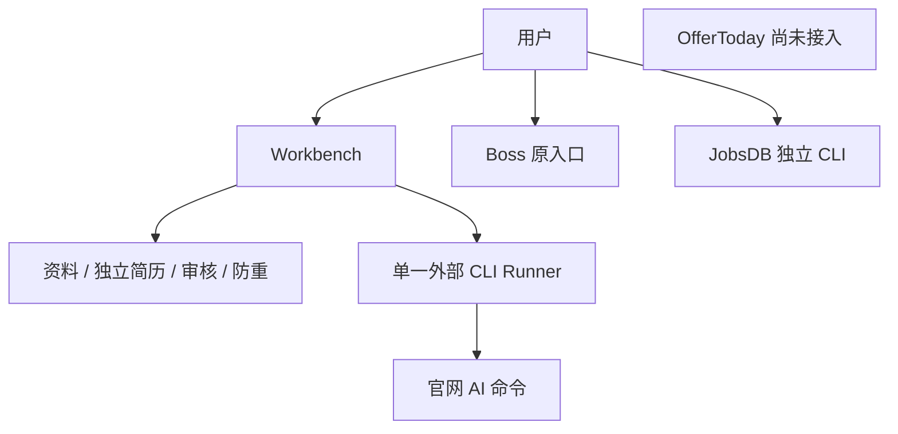
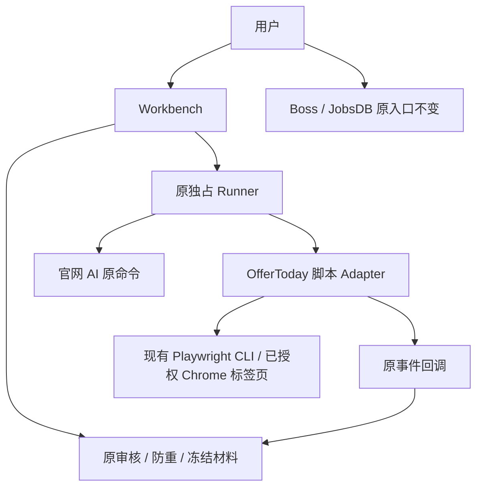
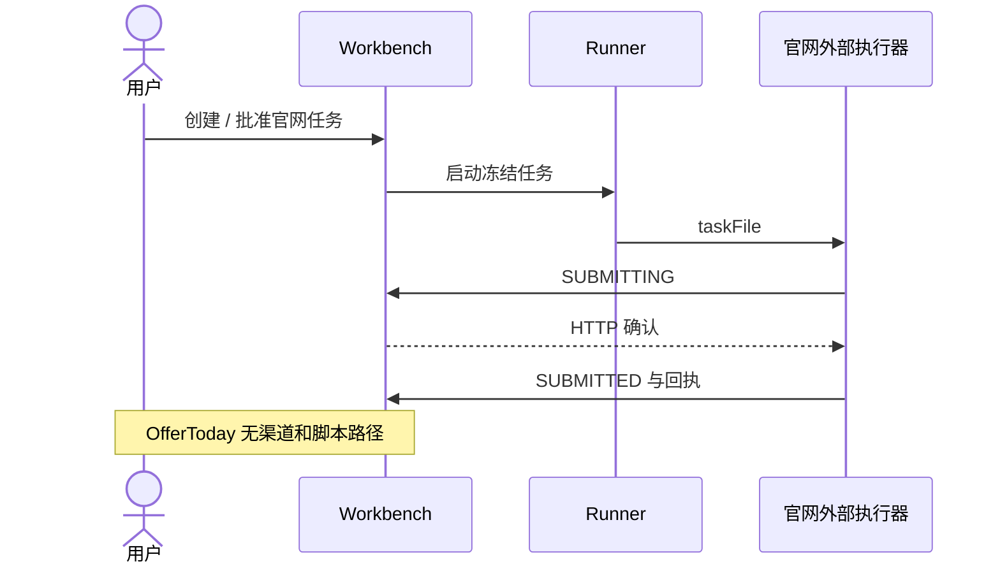
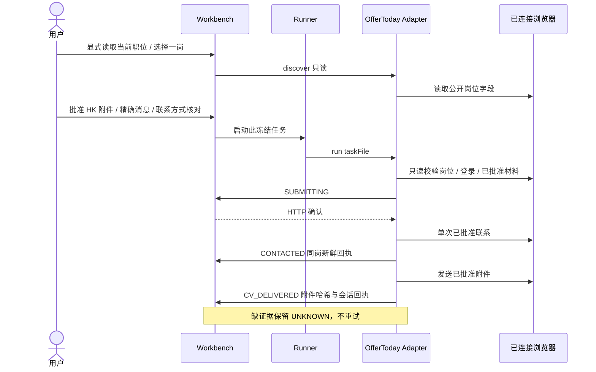
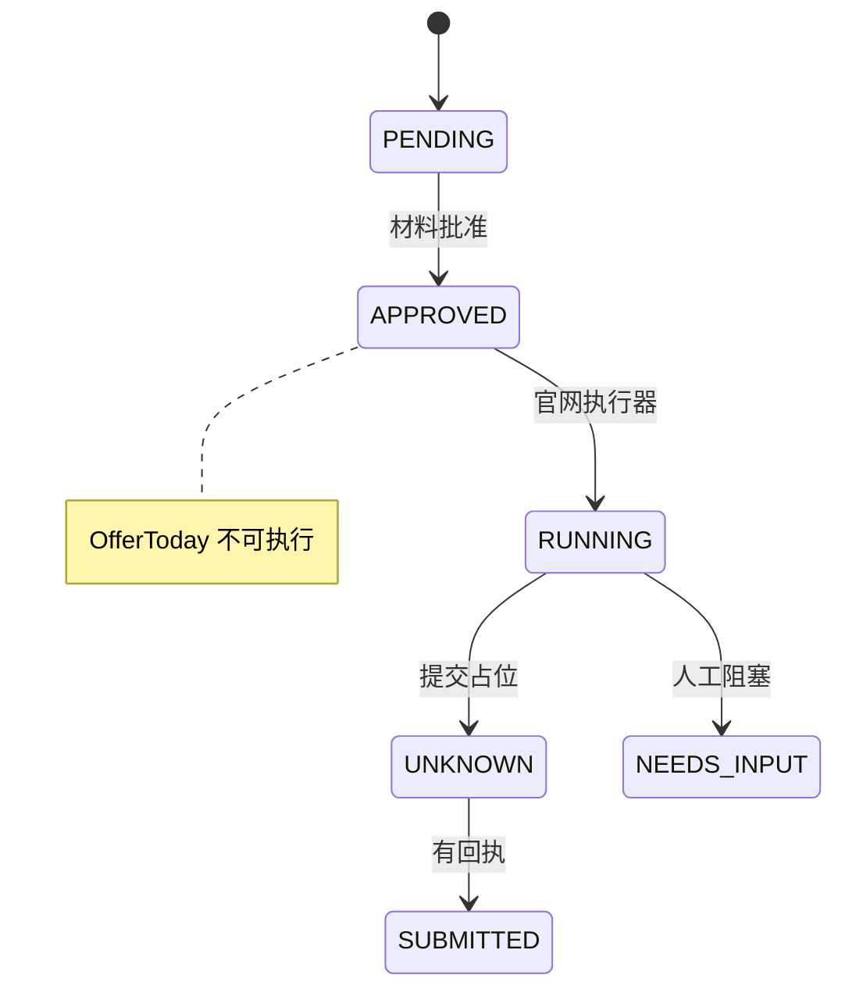
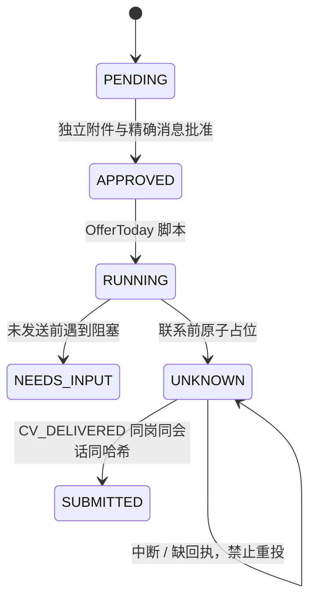
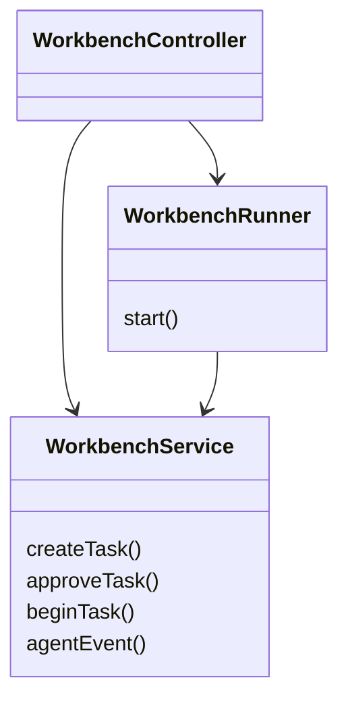
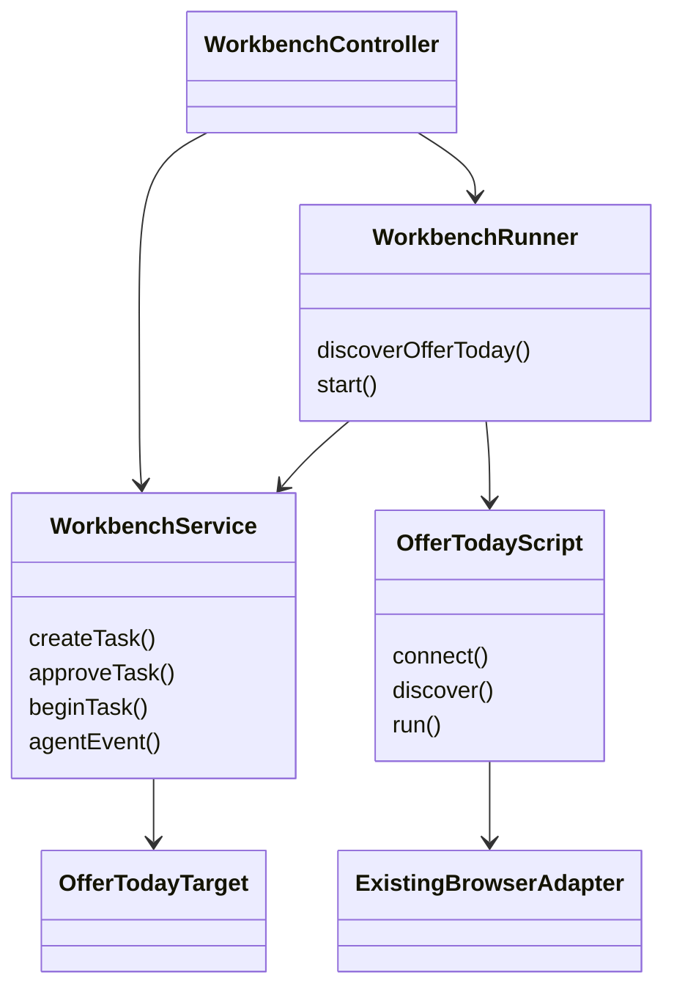

# OfferToday 港区平台接入 V1

> **公开找岗通过实站验证；随附自动发送暂不启用。** #25/#30 已将附件验收改为转换附件 A：输入 hash → 原生附件/账号/岗位/会话 → 本次实际 dispatch → 新鲜送达回执，不要求平台副本字节相同。当前两版生产 send registry 均为空，完整 A 归属及原生单次动作确认未核实，仍在 claim 前停止。既有不可变版本 fixture 不等于 A 已实现或真实 MATCH 已完成；账号里的普通手动申请不受影响。
>
> **2026-11-28 复核：** 用户已登录 `.offertoday/profile`，但登录状态不是 sender qualification，也不能替代 A 归属或原生单次动作确认。本轮没有可用的生产发送入口，未 claim、未发送，未产生 `CV_DELIVERED`；#30 保持能力停止，不把 profile 登录或只联系当成完成。

## 范围与交付

用户已明确要求实现平台接入，而非只连接浏览器或添加徽标。固定起点 `42e2cdb621d9886123257eb4e5c4e90abe683fd3`；在当前已跟踪的 `integrate/upstream-36bf5f9` 分支实施。原 `get_jobs/` 不操作，`get_jobs_jobsdb/` 的未提交改动和私有数据不动。

- 新增 `OFFERTODAY` 单岗申请渠道，仅 HK，保留中英文独立简历和岗位版本；不合并或自动覆写。
- 使用用户现有 Chrome、官方 Playwright 扩展和已授权标签页，不再新开登录浏览器、不复制 Cookie。连接元数据只放忽略的 `.offertoday/`，绝不提交账号数据。
- Python 标准库脚本复用已有 `playwright-cli`，提供 `connect`、只读 `discover`、冻结任务 `run`；正常流程不调用模型。不建立新浏览器 Agent 框架，不扩展成批次投递。
- 工作台提供平台入口、显式读取当前已加载职位、创建待审任务、批准精确首条消息及简历、启动脚本、人工阻塞和回执记录。官网 AI 仍走原命令，OfferToday 不依赖官网 AI 配置。
- OfferToday 详情链接规范化为已观察到的 HTTPS `www.offertoday.com/hk/job/<区分大小写的 opaque ID>`；根域输入别名统一到 www，历史 HTTP/根域详情链接也参与防重。本版只识别 `/hk/job/`，不猜测英文路径。路径 ID 是唯一岗位身份，查询参数不能绕过防重，旧官网渠道相同链接也参与防重。
- 首条消息必须明确填写并在批准时固定文本与 SHA256；用户须确认平台实际联系方式和线上资料已核对，不自动修改网站个人档案。缺少资料、验证码、未知控件或无法控制的自动招呼均停止等待人工。
- 核准输入必须为本次选定的 PDF/DOCX 原字节；平台可转换附件，但须满足下述 A 归属链。文本草稿或站内未知旧附件不能替代。控件不确定时 fail closed，不靠猜测点击“傳送訊息／發送履歷”。
- CONTACT/SEND_CV 各自必须先收到同一 task/attempt/stage 的 `SUBMITTING` 确认，每阶段最多一次。确认 `CONTACTED` 后才可继续同一 valid attempt 的 CV；模糊 CONTACT 不继续，CONTACTED 单独仍为 UNKNOWN。只有同一岗位/会话且完整 A 归属的 `CV_DELIVERED` 才进入 `SUBMITTED`；仅打招呼、选择文件或退出码 0 均不算完成，UNKNOWN 不重投。
- 只读招聘状态查询不自动借用官网 AI 处理 OfferToday；本版无可靠站点证据时明确不支持，不伪装为已查询。
- 自动发送开发只运行临时数据、fake 进程和全拦截浏览器 fixture。另经用户授权的一次官网单岗试点：首联按钮确实自动发送岗位卡和默认招呼；同岗会话随后显示自拟正文与独立 PDF 附件送达，「求職紀錄」也显示「已發起溝通」「已發送履歷」。未看到独立的「已投遞」或「已申請」回执，未再提交或重发。官网试点不启用自动发送。

## 能力与限制

- 随附脚本命令和隔离测试见仓库的 `scripts/offertoday/README.md`。普通 Chrome 连接缺失时只报告阻塞，不新建登录浏览器。连接文件可以指向已有 CLI workspace，不必重新 attach。
- 推荐/搜索卡片读取基于已观察的 `.jobCardTitle` 结构，仅读当前已加载的最多 40 个岗位，不翻页。公司字段取卡片公司的链接文字，不把工资/行业段落误当公司；执行时与同岗详情的公司或品牌核对。卡片没有全文 JD 时 description 留空，不补写或猜测。
- 本机 fake 执行器已通过真实 HTTP 回调验证先占位、再联系、最后附件回执的路径；这不是 OfferToday 真实消息或 CV 送达证明。进程退出产生的 UNKNOWN 不能替代本次成功的提交前占位。
- 现有发送 fixture 覆盖原生 store / API 绑定、附件不可变版本的严格字节校验、明确选择及独立服务端历史的新 own 文字/CV 记录；尚未实现转换附件 A。页面、账号、招聘者或材料变化即停止，不把本地 Loading、packet-send 或默认附件作为证据，也不把合成绑定用于生产。
- 整链路工作台 UI smoke 使用独立临时数据库和 fake 执行器：完整 CV 回执计数 1，仅联系保持 UNKNOWN、不计成功且不可重跑；官网 AI 未配置也能走独立 OfferToday 路径。结果不证明真实网站送达。

### 已自行核对的真实控件

仅导航和查看控件元数据，没有读取聊天正文、个人资料值或附件文件名，没有填消息、选文件、上传或确认发送。核对后取消简历选择器并恢复推荐页。

| 入口/控件 | 实际观察与边界 |
| --- | --- |
| 账号导航 | `個人檔案` → `/hk/profile`；`求職紀錄` → `/hk/applied-history`。由代理自行点击，不再等待用户打开。 |
| 顶部通知 | `button[class*="noticeButton"]` 的父容器触发 hover 通知列表；不是雇主聊天入口。 |
| 聊天面板 | 右下角 `svg[data-testid="chat-iconIcon"]` 所在的折叠 `.MuiPaper-root`；展开后有 `input[placeholder="搜尋招聘者姓名、公司名稱"]`。列表使用 `[data-index]` / `.MuiListItemButton-root`，可打开已有会话而不触发职位卡片申请。 |
| 消息编辑器 | `.js-message-input-editor[contenteditable="true"]`，不是 textarea。Enter 不带 Shift 会发送，开发探查不输入或按 Enter。 |
| 简历选择器 | `button[aria-label="open-resume"]:has(svg[data-testid="resume-icon-2Icon"])`。联系信息按钮也复用 `open-resume` aria，不能只按 aria 选取。打开选择器不发送；可能已预选默认附件，必须防止直接误确认。 |
| 确认/取消 | 简历选择器的 `發送` 是实际发送动作；`取消` 可安全关闭。文字与简历是分开发送，可以有不同消息 ID，不能强制同一条复合消息。 |
| 上传 | 真实附件选择接受 `.doc,.docx,.pdf,.jpg,.jpeg,.png`；选文件立即开始上传，必须先取得 claim，不能把选文件当只读预检。聊天中的 `open-image` 仅为图片，不是 PDF 简历入口。 |
| 消息/回执 | 消息列表为 `.otd-chat-message-list [data-id]`。不能用新 DOM 行、清空编辑器或 transport `packetsend` 当送达；需要区分服务端 `Sync_Message` 与本地 Loading，并把新简历卡的 resumeId 与本次上传结果绑定。没有观察到 DOM SHA 属性。 |

公开客户端显示，岗位详情页已登录的「傳送訊息」会先调用 `startChatV3`，成功后才打开编辑器；另有 `applyV3` 投递动作，二者都不是预览。试点岗位复查未见可先核对正文和附件的官网入口。首联请求没有用户编辑过的正文。获准的单次官网试点中，服务器在打开编辑器前发送了岗位卡和默认招呼，招呼提到线上履历；当时没有附件卡。只读探查不会点击这些控件，也不会直接调用对应接口。

### 发送适配合同（#25/#30：转换附件 A）

近期单岗试点从公开详情页观察到 `index.D4zvvLnm.js` 及其 `lang-DMtzyqWP.js` 导入。直接字符串搜索容易将入口包装层误认作接口变化；对比两版实际发布文件后，API、四个状态绑定和 root store 的初始化定义，在仅消除打包 source 路径差异后各有唯一结构对应。代码现按观察到的入口选择固定配对，禁止从任务或网页选择任意模块；发送阶段必须与预检采用同一版本，已关闭岗位不能进入原生联系。新版可以走公开页面读取。匿名公开页面实际加载的职位响应（见 `scripts/offertoday/fixtures/public-job-availability.json`）中，试点开放岗位为 `jobStatus: 2`，关闭岗位为 `jobStatus: 3`，且两条都没有 `isClosed`；随后对照两版发布详情组件，确认两者都使用严格的数字 `jobStatus === 2`。两版原生预检均只接受该开放值；旧版读取也不再把缺失、陌生或字符串状态当开放。已关闭或状态未知时仍可保留完整 JD 供查看。两阶段测试回放了这部分真实岗位响应；账号、编辑器和附件均为隔离 fixture。正文及 CV 的浏览器请求由独立本地 HTTP 接收器核对，接收器生成动作确认并另行提供历史读取。两版实际客户端的原生请求控制、输入到附件的 A 归属和单次动作确认均未取得生产资格，`dispatchProofByBuild` 对二者都没有生产实现，不能用配置或任务字段打开。现有策略脚本还缺 task owner 要求的只读 JD/账号/会话 `context` 和精确 stage 权限确认，不能编造 hash 补齐。缺动作确认或新 CV 历史时保留 `UNKNOWN`，不重投；真实两版及未知版本均在占位前停止。

**正文回执校验：** 两版发布编辑器会先 `trim()`，若冻结正文因此会改变，就在占位前停止，不代改。两版加载同一份公开 `chat.CPHUXtPm.proto`：应用层 `Sync_Message`（入口枚举值 `4`）携带 `clientMessageId` 与服务器 `messageId`。离线回放用两版原生解码器处理合成字节，验证正常同步、禁言标记以及大整数丢精度。校验要求从独立来源取得原始同步帧，无损解析同一原生请求的客户端 ID 和服务器 ID，再核对独立历史中的同 ID、会话和原文。历史若仅提供取整后的 ID，不算确认；禁言、未知扩展、畸形帧、解码后的对象及传输 `PUBACK` 也不算。实际网站可能在其他标签页代理发送；本地转发的 UI 事件不是独立网络确认。该校验不等于实际版本已接上可核验的发送与回执来源。

**附件权威合同 A：** 本地输入 SHA256 只证明选择并提交了哪份核准文件，不证明平台转换副本或招聘者下载字节相同。Adapter 须以可追踪证据把该输入关联到平台原生附件及同一账号/岗位/会话，再关联本次实际 dispatch 与独立新鲜 CV 回执。已有附件也必须有该输入来源，不能只比文件名、附件 ID、大小或默认勾选。不可变版本可作为关联证据的一种，不再是唯一可接受方案。Boss 同样适用，但未知自动招呼和未核实发送能力的阻断不变。

**简历未验收项：** 两版简历按钮向会话发送附件标识，未传不可变版本或字节哈希，这本身不否定 A。HTTP 通用封装可把成功响应的 `data` 传给调用者，按钮只关闭界面、不读取响应内容；因此不能从公开代码断言服务器有无可归属消息 ID。真正缺少的是可验证的输入→原生附件→本次 dispatch→新鲜回执的完整链。

仍需要平台允许的测试环境或可复核的脱敏轨迹：证明本次输入与原生附件/账号/岗位/会话的关联、实际请求及独立动作确认，再用独立历史核对本次正文与 CV 的不同平台消息 ID。若涉及新增附件，还须核实上传/保存关联与 effect 前的 SEND_CV claim。其他 tab、旧消息/旧回执、同内容历史、上传成功或一次按钮点击不够。官网手动单岗试点与受控自动发送的真实 MATCH 验收分开，由 lead/user 执行，不在 Pi worker 内实发。

1. 只复用已有、已授权的 Chrome 标签页，自己导航到批准岗位；现有未保存对话框或消息草稿不覆盖。已定位旧版 `index.BKzheqN_.js` / `lang-73AtwcZ1.js` 和新版 `index.D4zvvLnm.js` / `lang-DMtzyqWP.js` 的对应入口与 root store；不创建新的/default store、不猜新导出、不复制登录凭据。未知版本或原生发送语义未核实时在占位前停止。
2. 通过原生只读职位详情取得同一 `jobId`、`jobName`、公司/品牌别名与招聘者 ID；只用原生聊天状态入口打开该招聘者的编辑器，不点击有默认副作用的 Chat/Apply。账号与招聘者必须在两个发送阶段保持一致。
3. 首次 claim 前只读核对附件来源、容量、审核及 A 归属能力，正文与 CV 阶段分别复核本次绑定。已存在附件必须能追踪至冻结输入，不能仅凭下载、文件名、预览或默认项复用。一次官网试点中，从已发卡片下载的 PDF 与输入 hash 不同；文本除新增前缀外一致，但这不能证明招聘者端字节或完整 A 链。两版账号附件与聊天卡走不同下载入口，聊天卡传附件 ID；不要求另造不可变版本，却仍必须证明本次关联。审核未完成、来源不明、歧义或容量不足在联系前阻塞，不删除其他附件、不改默认简历。
4. `SUBMITTING` 得到确认后，核对文字与附件，在按 Enter 前读取同会话最新服务端历史；若核对附件期间出现新历史，不发正文，不进入附件阶段。正文编辑器在发送准备及按键派发时都须为与冻结正文逐字一致的纯文本；不允许靠 `trim()`、浏览器空白折叠或富文本结构把不同内容当成相同。发送后从直接服务端历史验证新 own/fromSn、目标 toSn、精确正文与新编号；新编号不能已见，并须晚于正文发送前的历史标记。先持久登记并确认 `CONTACTED`，才能进入附件步骤。
5. 收到同一 valid attempt 的 CONTACTED 确认后，重新核对范围/材料/目标/context 并独立取得 SEND_CV claim，才可选文件、上传、保存或发送 CV。新增文件的实际输入字节须匹配核准 hash，上传/保存所得原生附件与账号/岗位/会话可追踪；已有附件也须复核输入来源。实际选项及原生请求必须指向已核验附件，不能以旧默认项兜底。非发送 trial 完成后、实际点击前，取得同会话的最新服务端历史基线；之后不再等待按钮，精确控件须当场可用且命中检查通过。实际原生处理入口须重核岗位、客户端、账号、会话和载荷，异步让出后在不可逆操作前再核；事件捕获只是预过滤。动作确认与独立历史均须指向本次 dispatch 的附件关联；CV 消息 ID 必须不同于 CONTACT、不在基线中且晚于基线与联系回执（同时间戳用更大服务器序号）。正文与 CV 之间已有的相同附件消息、其他 tab 的发送均不能当本次回执。身份/请求变化、无法证明覆盖真实原生处理器或缺少任一归属环节即停止，已有 claim 保留 UNKNOWN，不重投。临时守卫随操作释放。
6. 本次动作必须先独立取得其对应的平台消息 ID，再由直接服务端历史证明同 ID 已保存；没有动作确认时不能从历史挑一个匹配的 ID。本地消息 atom、Loading、packet-send、编辑器清空或上传/保存成功均不够。回调只带本次岗位/尝试/会话/新消息及批准输入哈希等必要证据，不返回聊天历史、CV 内容、Cookie 或 token。`SUBMITTED` 不保证招聘者端字节一致、雇主已读或原生 application/「求職紀錄」状态更新。

现有 `browser.js` 的合格 fixture 分支仍以 `pinResume`/不可变版本/字节复验实现旧严格合同；尚无 A 的转换关联 Adapter，也未接通策略只读 context。上述条目是经 #25/#30 更新的验收合同，不是生产能力声明。不能删除旧检查、填一个 registry 路径或打开 flag 就声称支持 A。

## Seam 与知识归属

Workbench Module 拥有材料冻结、逐岗授权、防重、事件与任务运行独占。OfferToday Adapter 拥有域名/岗位身份、浏览器控件和回执识别；浏览器适配复用现有 CLI，不把网页细节放入前端或官网 AI 提示词。Runner 只增加一个真实存在的脚本分派路径：`WORKBENCH_OFFERTODAY_COMMAND` 是脚本参数前缀，后附 `discover` 或 `run taskFile`；未配置/脚本缺失不得伪装可用。仓库运行可使用随附脚本的默认前缀，显式空数组禁用。`OFFERTODAY_BROWSER_WORKDIR`、`OFFERTODAY_BROWSER_SESSION` 定位已批准的现有连接，`run/discover` 绝不自行登录或新开浏览器。

以下八图是 #6 V1 历史设计：四张「当前」图固定于 `42e2cdb`，目标图也保留当时合同，不作为 #30 的现行设计或实站验收。#30 的本地 sequence 与能力阻断见 [本票 Mermaid Gate](https://github.com/liu-qingyuan/get_jobs/issues/30#issuecomment-7208468122)；CONTACT/SEND_CV 公共状态不变。

## 当前架构

## 目标架构

## 当前时序

## 目标时序

## 当前状态

## 目标状态

## 当前局部类

## 目标局部类

## 验收

- [x] 已补齐并逐图检查当前/目标架构、时序、状态、类图共八张图。
- [x] HK 渠道、受控主机和 opaque 岗位 ID、查询参数防重及旧记录防重有公开 Interface 回归。
- [x] 港区独立附件、精确消息和适用事实冻结；不调用 AI 或修改平台个人档案。
- [x] 无官网 AI 配置也能独立分派 OfferToday 脚本；未连接浏览器时明确等待人工，不新开登录会话。
- [x] 工作台可只读读取当前职位并选择创建任务；可批准、启动和记录分开的联系/简历回执（隔离 UI smoke）。
- [x] 脚本通过 claim 确认才发送；仅联系、错误附件哈希、旧回执、掉线和中断都不伪报成功或重试（隔离原生客户端/DOM fixture）。
- [x] Java、Python、浏览器 fixture、TypeScript、lint 与构建通过；Boss/JobsDB/官网原合同回归。
- 审查与交付记录：[issue #6](https://github.com/liu-qingyuan/get_jobs/issues/6)（固定范围双轴 review、一次 clean 与必要 focused closure）。
- [x] 不触碰原目录/私有数据，不发真实消息或简历；源码、fixture、只读观察与真实发送验收分开记录。

### 本轮验证记录

本轮 67 项 Java（含 12 项全拦截 Boss DOM fixture）、40 项 OfferToday Python（19 项合同/工作流单元 + 21 项全路由拦截原生客户端/DOM fixture）、4 项 reporter、38 项 JobsDB，共 **149 项通过**；Java 0 failure/error/skip。TypeScript、作用域 ESLint、Next 生产构建与 bootJar 通过。真实只读 `discover` 通过原私有连接读取 10 个已加载岗位；只读详情确认 jobId、标题及公司/品牌与新读取结果一致，不翻页、不创建任务、未联系或上传。

临时 SQLite + 打包应用 + fake 执行器的 UI smoke 验证 HK 英文 PDF 审核、只读预填不自动建任务、单岗批准/启动、分开的新消息回执、CV 成功数 1 而非联系数 2、UNKNOWN 禁止重跑、无官网 AI 也能执行，重载后状态保留。独立浏览器的最终 console 为 0 error；测试专用代理仅把既有硬编码健康检查端口转发到自有临时服务，未访问原运行副本。

原生 fixture 复用已观察的真实控件/客户端合同，但服务器和材料仍是合成数据，**不证明实际招聘网站已接受任何真实消息或简历**。不以本轮测试冒充实投验收；审查与交付状态统一记录在 issue #6，不在本页维护易过时的 issue 开关状态。

## Git

- Branch: `integrate/upstream-36bf5f9`
- Base branch: `integrate/upstream-36bf5f9`
- Base commit: `42e2cdb621d9886123257eb4e5c4e90abe683fd3`
