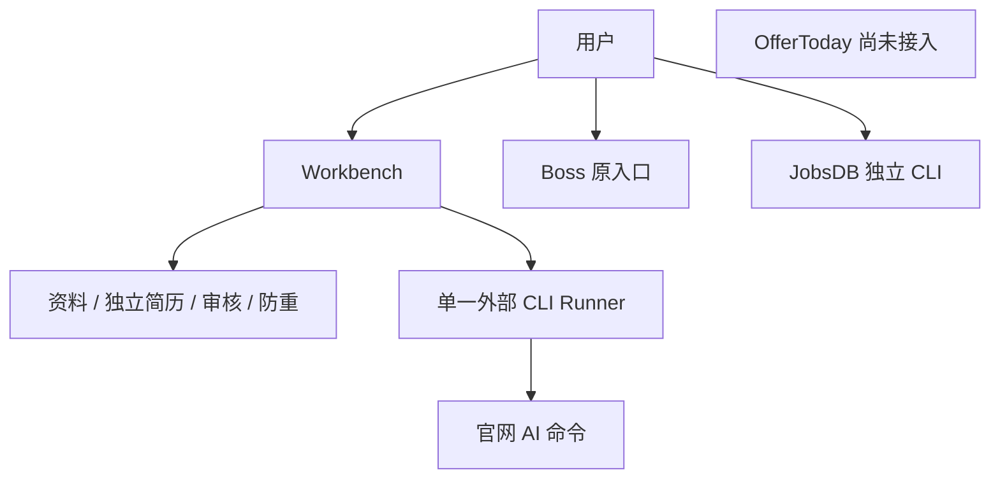
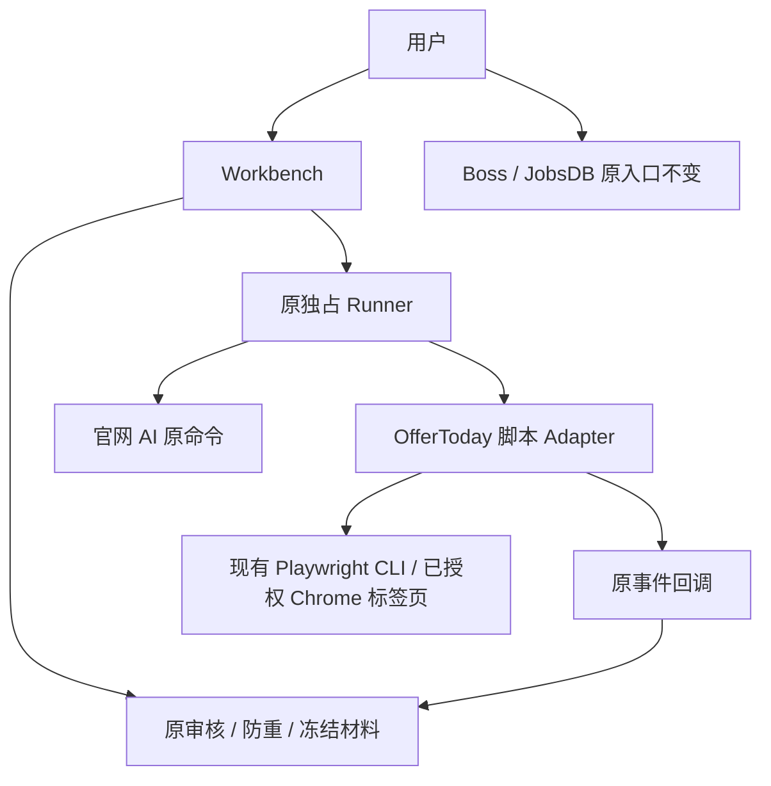
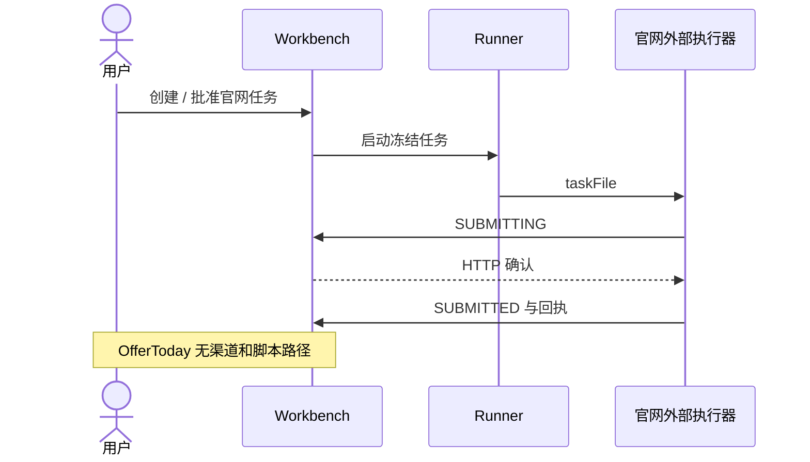
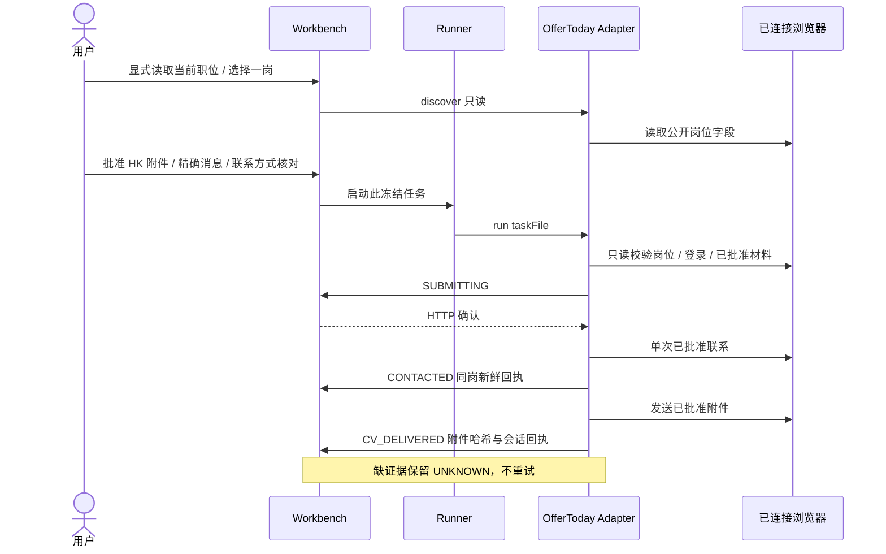
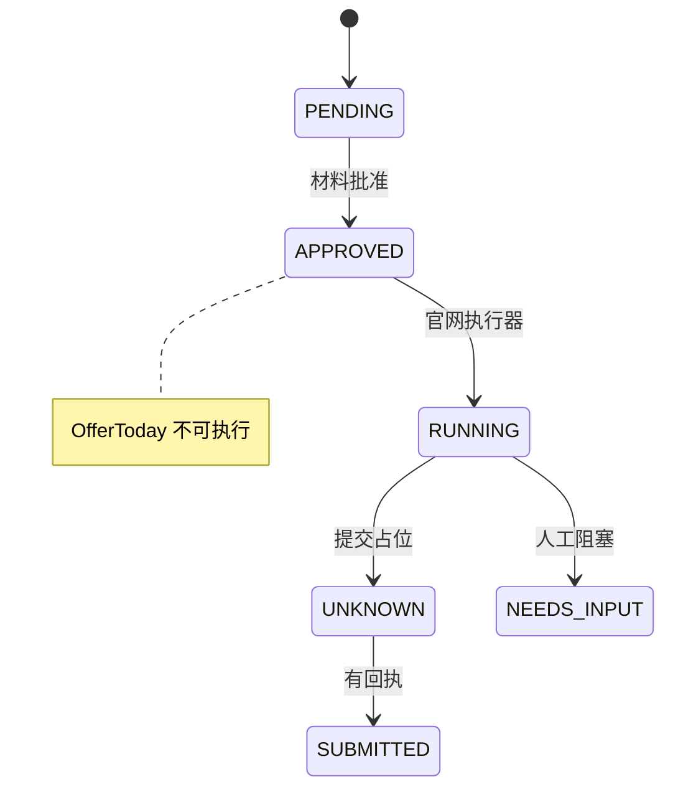
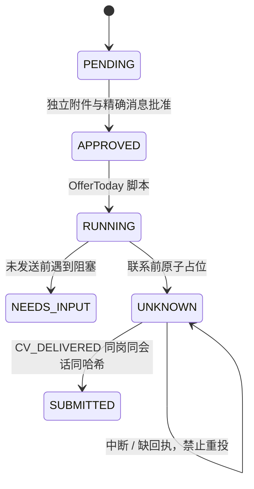
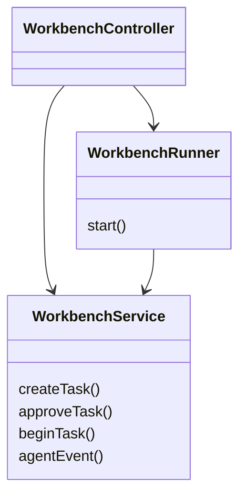
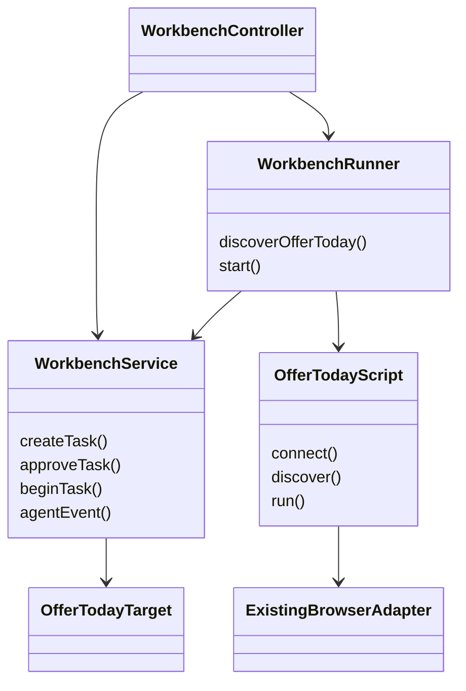

# OfferToday 港区平台接入 V1

> **原生发送 Adapter 已实现；实现能力与验证边界如下。** 渠道、材料审核/冻结、防重、独占启动、字节校验与双阶段回执均有实现；真实已授权 Chrome 只读读取了 10 个岗位，并自行核对了聊天与简历选择器，无需用户代操作。发送使用真实控件和已验证原生客户端，不再使用虚构的 DOM auth/会话/SHA 属性。开发未发送、上传或试投；隔离 fixture 不等同于真实送达验收。

## 范围与交付

用户已明确要求实现平台接入，而非只连接浏览器或添加徽标。固定起点 `42e2cdb621d9886123257eb4e5c4e90abe683fd3`；在当前已跟踪的 `integrate/upstream-36bf5f9` 分支实施。原 `get_jobs/` 不操作，`get_jobs_jobsdb/` 的未提交改动和私有数据不动。

- 新增 `OFFERTODAY` 单岗申请渠道，仅 HK，保留中英文独立简历和岗位版本；不合并或自动覆写。
- 使用用户现有 Chrome、官方 Playwright 扩展和已授权标签页，不再新开登录浏览器、不复制 Cookie。连接元数据只放忽略的 `.offertoday/`，绝不提交账号数据。
- Python 标准库脚本复用已有 `playwright-cli`，提供 `connect`、只读 `discover`、冻结任务 `run`；正常流程不调用模型。不建立新浏览器 Agent 框架，不扩展成批次投递。
- 工作台提供平台入口、显式读取当前已加载职位、创建待审任务、批准精确首条消息及简历、启动脚本、人工阻塞和回执记录。官网 AI 仍走原命令，OfferToday 不依赖官网 AI 配置。
- OfferToday 详情链接规范化为已观察到的 HTTPS `www.offertoday.com/hk/job/<区分大小写的 opaque ID>`；根域输入别名统一到 www，历史 HTTP/根域详情链接也参与防重。本版只识别 `/hk/job/`，不猜测英文路径。路径 ID 是唯一岗位身份，查询参数不能绕过防重，旧官网渠道相同链接也参与防重。
- 首条消息必须明确填写并在批准时固定文本与 SHA256；用户须确认平台实际联系方式和线上资料已核对，不自动修改网站个人档案。缺少资料、验证码、未知控件或无法控制的自动招呼均停止等待人工。
- 发送必须使用本次批准的 PDF/DOCX 附件；文本草稿不能冒充可发送文件，不用站内未知旧附件替代。对当前站点控件不确定时 fail closed，不靠猜测点击“傳送訊息／發送履歷”。
- 联系前必须收到 `SUBMITTING` 的 HTTP 确认。`CONTACTED` 只说明首条消息有新鲜同岗回执；`CV_DELIVERED` 还须绑定同一会话和冻结附件哈希，才进入 `SUBMITTED`。仅打招呼、选择文件或退出码 0 均不算投递成功；UNKNOWN 不重投。
- 只读招聘状态查询不自动借用官网 AI 处理 OfferToday；本版无可靠站点证据时明确不支持，不伪装为已查询。
- 开发只运行临时数据、fake 进程和全拦截浏览器 fixture。现有账号只读观察和可选的职位读取验收，不发真实消息、不上传真实简历、不实投。

## 能力与限制

- 随附脚本命令和隔离测试见仓库的 `scripts/offertoday/README.md`。普通 Chrome 连接缺失时只报告阻塞，不新建登录浏览器。连接文件可以指向已有 CLI workspace，不必重新 attach。
- 推荐/搜索卡片读取基于已观察的 `.jobCardTitle` 结构，仅读当前已加载的最多 40 个岗位，不翻页。公司字段取卡片公司的链接文字，不把工资/行业段落误当公司；执行时与同岗详情的公司或品牌核对。卡片没有全文 JD 时 description 留空，不补写或猜测。
- 本机 fake 执行器已通过真实 HTTP 回调验证先占位、再联系、最后附件回执的路径；这不是 OfferToday 真实消息或 CV 送达证明。进程退出产生的 UNKNOWN 不能替代本次成功的提交前占位。
- 已替换原合成发送驱动：原生 store / API 绑定、审核附件原始 blob 字节校验、明确选择目标简历，以及直接服务端历史中的新 own 文字/简历记录。页面、账号、招聘者或材料变化即停止，不把本地 Loading、packet-send 或默认附件作为证据。
- 整链路工作台 UI smoke 使用独立临时数据库和 fake 执行器：完整 CV 回执计数 1，仅联系保持 UNKNOWN、不计成功且不可重跑；官网 AI 未配置也能走独立 OfferToday 路径。结果不证明真实网站送达。

### 已自行核对的真实控件

仅导航和查看控件元数据，没有读取聊天正文、个人资料值或附件文件名，没有填消息、选文件、上传或确认发送。核对后取消简历选择器并恢复推荐页。

| 入口/控件 | 实际观察与边界 |
| --- | --- |
| 账号导航 | `個人檔案` → `/hk/profile`；`求職紀錄` → `/hk/applied-history`。由代理自行点击，不再等待用户打开。 |
| 顶部通知 | `button[class*="noticeButton"]` 的父容器触发 hover 通知列表；不是雇主聊天入口。 |
| 聊天面板 | 右下角 `svg[data-testid="chat-iconIcon"]` 所在的折叠 `.MuiPaper-root`；展开后有 `input[placeholder="搜尋招聘者姓名、公司名稱"]`。列表使用 `[data-index]` / `.MuiListItemButton-root`，可打开已有会话而不触发职位卡片申请。 |
| 消息编辑器 | `.js-message-input-editor[contenteditable="true"]`，不是 textarea。Enter 不带 Shift 会发送，开发探查不输入或按 Enter。 |
| 简历选择器 | `button[aria-label="open-resume"]:has(svg[data-testid="resume-icon-2Icon"])`。联系信息按钮也复用 `open-resume` aria，不能只按 aria 选取。打开选择器不发送；可能已预选默认附件，必须防止直接误确认。 |
| 确认/取消 | 简历选择器的 `發送` 是实际发送动作；`取消` 可安全关闭。文字与简历是分开发送，可以有不同消息 ID，不能强制同一条复合消息。 |
| 上传 | 真实附件选择接受 `.doc,.docx,.pdf,.jpg,.jpeg,.png`；选文件立即开始上传，必须先取得 claim，不能把选文件当只读预检。聊天中的 `open-image` 仅为图片，不是 PDF 简历入口。 |
| 消息/回执 | 消息列表为 `.otd-chat-message-list [data-id]`。不能用新 DOM 行、清空编辑器或 transport `packetsend` 当送达；需要区分服务端 `Sync_Message` 与本地 Loading，并把新简历卡的 resumeId 与本次上传结果绑定。没有观察到 DOM SHA 属性。 |

公开客户端同时证明职位卡片的 Chat/Apply 会先调用 `startChatV3` / `applyV3`，然后才打开聊天；这些不是只读导航。其自动招呼/默认履历副作用未经核实时，不点击来探查。源代码研究只取公开静态资源，不调用这些接口或读取账号凭据。

### 发送适配合同

1. 只复用已有、已授权的 Chrome 标签页，自己导航到批准岗位；现有未保存对话框或消息草稿不覆盖。当前支持的原生客户端版本为 `index.BKzheqN_.js` / `lang-73AtwcZ1.js`，后者导出真实 root store；不创建新的/default store、不猜新导出、不复制登录凭据。版本变化时发送前阻塞。
2. 通过原生只读职位详情取得同一 `jobId`、`jobName`、公司/品牌别名与招聘者 ID；只用原生聊天状态入口打开该招聘者的编辑器，不点击有默认副作用的 Chat/Apply。账号与招聘者必须在两个发送阶段保持一致。
3. 仅下载/哈希本次已批准文件名对应的候选附件原始 blob，并与冻结 SHA256 和大小比较，不读/发送未知默认附件或预览转换件。审核未完成、同名歧义或附件已满且没有精确匹配时，联系前阻塞；不删除其他附件、不改默认简历。
4. `SUBMITTING` 得到确认后，单次发送精确文字；从直接服务端历史 `getHistoryMsgs(friendId, lastMessageId=-1)` 验证新 own/fromSn、目标 toSn、消息内容与新编号。先持久登记并确认 `CONTACTED`，才能进入附件步骤。
5. 已有文件必须重新核对材料绑定；新增文件只能在已占位后上传，使用原生上传/保存/简历选择器，不能以旧默认附件兜底。确认前选择明确、已核验的附件 ID；发送后须在同一会话的直接服务端历史找到新的简历卡和该 resumeId。文字和简历消息 ID 必须不同。
6. 直接历史记录才是平台保存证据，本地消息 atom、Loading、packet-send、编辑器清空或上传/保存成功均不够。回调只带本次岗位/尝试/会话/新消息及批准材料哈希等必要证据，不返回聊天历史、CV 内容、Cookie 或 token。`SUBMITTED` 不保证雇主已读或站内「求職紀錄」已更新。

## Seam 与知识归属

Workbench Module 拥有材料冻结、逐岗授权、防重、事件与任务运行独占。OfferToday Adapter 拥有域名/岗位身份、浏览器控件和回执识别；浏览器适配复用现有 CLI，不把网页细节放入前端或官网 AI 提示词。Runner 只增加一个真实存在的脚本分派路径：`WORKBENCH_OFFERTODAY_COMMAND` 是脚本参数前缀，后附 `discover` 或 `run taskFile`；未配置/脚本缺失不得伪装可用。仓库运行可使用随附脚本的默认前缀，显式空数组禁用。`OFFERTODAY_BROWSER_WORKDIR`、`OFFERTODAY_BROWSER_SESSION` 定位已批准的现有连接，`run/discover` 绝不自行登录或新开浏览器。

以下八图中的四张「当前」图固定于实施前的 `42e2cdb`，目标图描述本票合同；它们不是实站发送验收记录。

## 当前架构

## 目标架构

## 当前时序

## 目标时序

## 当前状态

## 目标状态

## 当前局部类

## 目标局部类

## 验收

- [x] 已补齐并逐图检查当前/目标架构、时序、状态、类图共八张图。
- [x] HK 渠道、受控主机和 opaque 岗位 ID、查询参数防重及旧记录防重有公开 Interface 回归。
- [x] 港区独立附件、精确消息和适用事实冻结；不调用 AI 或修改平台个人档案。
- [x] 无官网 AI 配置也能独立分派 OfferToday 脚本；未连接浏览器时明确等待人工，不新开登录会话。
- [x] 工作台可只读读取当前职位并选择创建任务；可批准、启动和记录分开的联系/简历回执（隔离 UI smoke）。
- [x] 脚本通过 claim 确认才发送；仅联系、错误附件哈希、旧回执、掉线和中断都不伪报成功或重试（隔离原生客户端/DOM fixture）。
- [x] Java、Python、浏览器 fixture、TypeScript、lint 与构建通过；Boss/JobsDB/官网原合同回归。
- 审查与交付记录：[issue #6](https://github.com/liu-qingyuan/get_jobs/issues/6)（固定范围双轴 review、一次 clean 与必要 focused closure）。
- [x] 不触碰原目录/私有数据，不发真实消息或简历；源码、fixture、只读观察与真实发送验收分开记录。

### 本轮验证记录

本轮 67 项 Java（含 12 项全拦截 Boss DOM fixture）、39 项 OfferToday Python（19 项合同/工作流单元 + 20 项全路由拦截原生客户端/DOM fixture）、4 项 reporter、38 项 JobsDB，共 **148 项通过**；Java 0 failure/error/skip。TypeScript、作用域 ESLint、Next 生产构建与 bootJar 通过。真实只读 `discover` 通过原私有连接读取 10 个已加载岗位；只读详情确认 jobId、标题及公司/品牌与新读取结果一致，不翻页、不创建任务、未联系或上传。

临时 SQLite + 打包应用 + fake 执行器的 UI smoke 验证 HK 英文 PDF 审核、只读预填不自动建任务、单岗批准/启动、分开的新消息回执、CV 成功数 1 而非联系数 2、UNKNOWN 禁止重跑、无官网 AI 也能执行，重载后状态保留。独立浏览器的最终 console 为 0 error；测试专用代理仅把既有硬编码健康检查端口转发到自有临时服务，未访问原运行副本。

原生 fixture 复用已观察的真实控件/客户端合同，但服务器和材料仍是合成数据，**不证明实际招聘网站已接受任何真实消息或简历**。不以本轮测试冒充实投验收；审查与交付状态统一记录在 issue #6，不在本页维护易过时的 issue 开关状态。

## Git

- Branch: `integrate/upstream-36bf5f9`
- Base branch: `integrate/upstream-36bf5f9`
- Base commit: `42e2cdb621d9886123257eb4e5c4e90abe683fd3`
