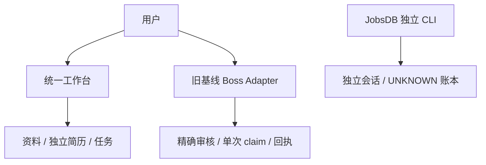
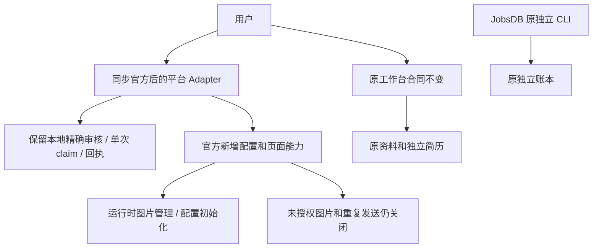
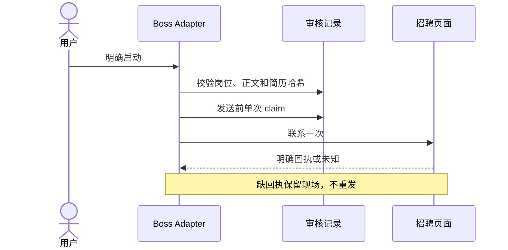
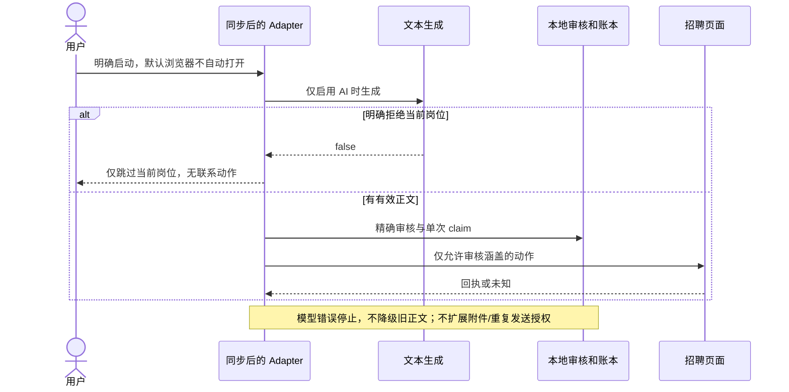
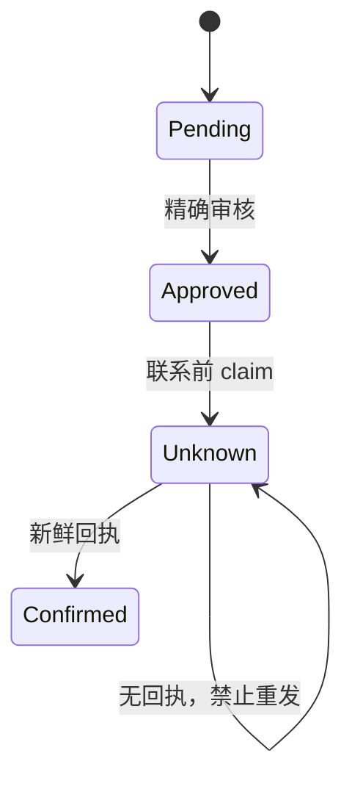
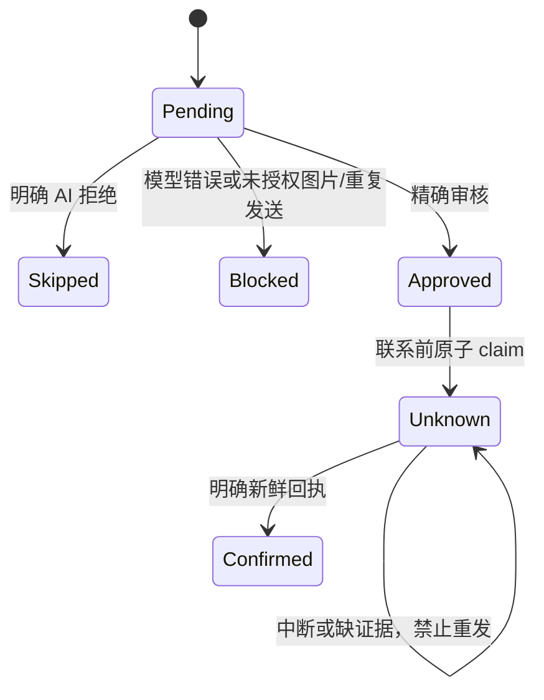
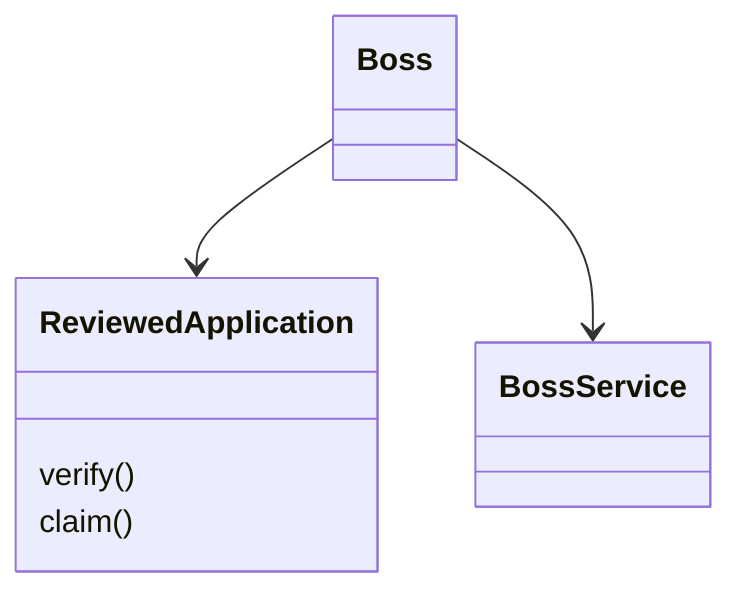
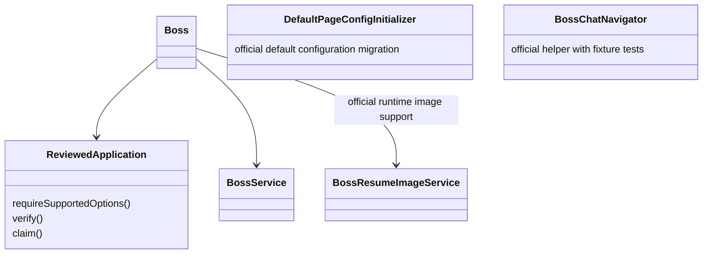

# 官方上游同步与兼容验证

## 固定范围

- 当前统一版：`58e060b1e967227948990da6e6c2c11680950c00`。
- 官方目标：`loks666/get_jobs` 的 `36bf5f986fad93374d77b99205c7684f8450874a`（2026-11-03）。
- 共同基线后官方 35 个提交；使用真实 merge ancestry，不把手工拷贝冒充已同步。
- 独立分支 `integrate/upstream-36bf5f9`，工作树 `/Users/liuqingyuan/work/get_jobs_upstream_sync`。当前统一目录和原国内目录、私有数据与未提交改动保持不动。
- 合入上游源码、页面配置初始化、猎聘改版适配、全国筛选、招呼语和聊天辅助逻辑；保留统一工作台、独立简历和资料作用域。
- Boss 必须保留精确、时效、单次审核，发送前 claim、明确回执才成功、未知结果不重试。模型失败不能退回旧招呼语；明确 AI 拒绝只跳过当前岗位。
- 上游图片简历管理和重复沟通配置可同步，但未经独立附件/重复发送审核的动作继续关闭；界面明确限制，不宣称所有新选项均可安全发送。
- 默认不启动招聘浏览器。只用临时数据库、假资料、拦截 fixture 和本机页面验证；不登录、不实投，不复制账号/Cookie/真实简历。

## 最小接缝

平台 Adapter 拥有网页和配置迁移知识；`ReviewedApplication` 拥有单岗正文/附件哈希及一次性尝试合同；工作台 Module 和通用执行器合同不扩大。官方新图片存储不得重新进入 JAR 资源，未知结果不得因上游成功计数代码而改成已发送。

## 当前架构

## 目标架构

## 当前时序

## 目标时序

## 当前状态

## 目标状态

## 当前局部类

## 目标局部类

## 验收

- [x] 官方目标 SHA 是最终集成分支的 ancestor，官方目标相对该分支 missing commits 为 0。
- [x] 明确记录冲突文件与取舍；所有本地审核、回执、防重、工作台接口保留。
- [x] 上游测试和工作台/JobsDB 测试通过；新增针对 AI 拒绝、模型失败、未授权附件/重复发送的必要回归。
- [x] 前端类型检查、构建和本机假资料 smoke 通过。
- [x] 界面/文档区分“源码已同步”“fixture 通过”“真实平台待验收”，不误报线上兼容。
- [x] 相关固定范围双轴 review 完成，原工作树/私有资料保持不变；整合/切换另按用户授权执行。

## 兼容取舍与验证边界

- 4 处 Git 冲突：`.gitignore` 合并两侧私有目录及文档构建忽略；Gradle 同时保留新旧测试/工作台任务和上游资源简历打包排除；PlaywrightManager 采用上游异步专用线程探测并保留本地隔离/登录保护；Boss 发送保持本地审核、预先 claim 和新鲜回执，吸收上游 AI 明确拒绝语义与图片管理代码。
- Boss 的授权边界不等于官方宽松发送行为：上游 `BossChatNavigator` 辅助器及其 DOM 测试保留，但本地单岗发送路径不以其返回聊天输入框作为身份或发送成功证明，不自动改成弹窗后再发送第二条消息。真实聊天页面仍需用户授权验收。
- 本版保留管理页默认不开招聘浏览器；Boss 页面提供明确的登录按钮，复用原有 `/api/boss/login`，只打开本项目浏览器，不自动填写账号或开始投递。开发中只用 mock 验证，不调用真实登录。
- 所有本地应用入口统一使用既有 Host/Origin 检查，包括运行时图片 API；不再按原始 URI 前缀跳过检查，避免编码路径和新增端点绕过本地访问合同。此项已用真实 localhost 编码请求复现，并有回归测试。
- 运行时图片管理与重复消息字段迁移已保留；自动图片/重复发送在本审核版关闭。旧开启值在界面如实显示，用户可明确关闭后保存，不清空已存跟进文本或图片。
- 新库默认配置不使用作者示例自我介绍、8 年经历、资深/地域/薪资偏好或黑名单；默认 dry-run，AI 和图片关闭。已有配置不覆盖。
- 合并后编译/测试、浏览器 fixture、前端构建、本机页面检查分别记录。未测试真实招聘账号、验证码、真实送达，不声称官网全兼容。当前工作树与原目录的数据未迁移。

## 验证记录

- Java：52 项通过，0 failure/error/skip。其中 12 项是官方聊天导航辅助器的全路由拦截 Chrome DOM fixture，不是本地发送器或真实招聘网站的整链路验收。
- JobsDB：38 项 fixture 通过；工作台 reporter：3 项通过。共 93 项测试，不调用真实模型或提交岗位。
- TypeScript、Next 生产构建、VitePress 文档构建通过。相关 ESLint 为 0 error、7 个既有 warning；Java 保留既有弃用提示。
- JAR 不包含旧根资源简历；此前已用合成资源简历验证打包排除。
- 临时数据库与打包后的本机应用验证：旧开启值如实展示、明确关闭后保存且保留跟进文本，招呼语可编辑、全国名称/代码字典正确往返，工作台入口正常，浏览器控制台 0 error。登录按钮只核对存在，未点击真实登录。
- 实际 localhost 请求验证原始/编码路径和首页的恶意 Host/Origin 均被拒绝；正常本机页面及保存继续可用。
- 主副本的用户未提交 patch 与初始快照逐字节一致；原国内 Java 修改亦一致，两个 HEAD 分别仍为 `58e060b`、`5edc0e6`。
- Broad Standards/Spec 均接受实施方向；文档中残留的宽松发送操作说明已纠正，固定 76 文件范围完成一次清理，保留 Markdown 换行语义，未新增依赖或功能。
- 上轮 Focused Closure 尝试恢复原 Standards（`26b74bfb-b1fc-4f6`）与 Spec（`2e3236b8-f526-496`）时均返回 Agent not found，已按当轮预算停止，没有启动替代 reviewer。用户随后明确授权单独重开仅文档复审，通过后发布隔离分支；本轮不重新审查或修改生产代码，不做真实登录或投递。
- 本轮仅文档 Standards（`193f7b87-b58e-448`）与 Spec（`b32ae1f2-4951-46d`）均接受方向，Focused Closure 均无 Critical/High 阻塞：原图片/重复发送说明冲突已关闭，新指出的通知与猎聘限额保证亦已修正关闭；README 启动步骤统一为显式禁用自动浏览器的 `workbench` 入口。本轮四次审查调用结束，不追加第三轮。
- 文档修复后的 VitePress 构建、定向合同断言、`git diff --check` 通过；生产代码与先前通过 93 项回归的版本一致，原主副本 patch 与原国内 Java patch 再次逐字节核对一致。

## Git

- 合并提交：`65eaf6dc700123e20eca633003e94ba2888552e3`，父提交分别为 V1 `58e060b` 和官方 `36bf5f9`。已验证官方 ancestry、missing commits = 0，以及纳入 35 个官方提交；再次查询官方 main 仍为该目标 SHA。
- 发布前仅将两条未发布集成提交的自动本机身份更正为 V1 已公开的 Git 身份，源码树、原 V1 分支和官方历史均未改变，未修改全局 Git 配置。
- 用户已确认文档复审通过后发布到 `origin/integrate/upstream-36bf5f9`；不推送原统一分支，不切换原运行目录。复审与远程 SHA 验证完成后才关闭 issue。
- Branch: `integrate/upstream-36bf5f9`
- Base branch: `codex/jobsdb`
- Base commit: `58e060b1e967227948990da6e6c2c11680950c00`
- Upstream target: `36bf5f986fad93374d77b99205c7684f8450874a`
