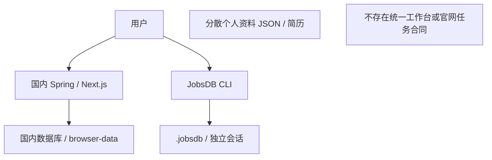
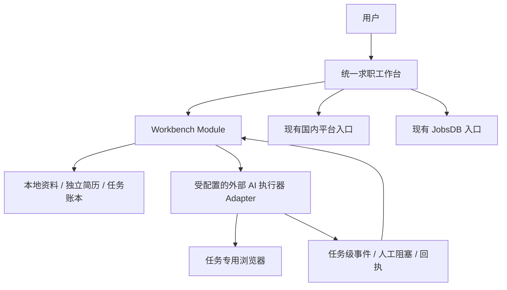
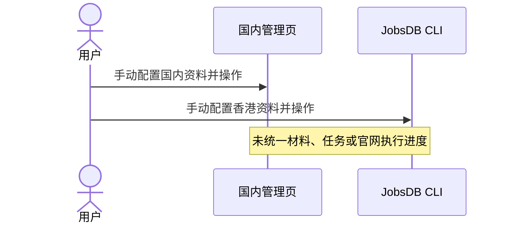
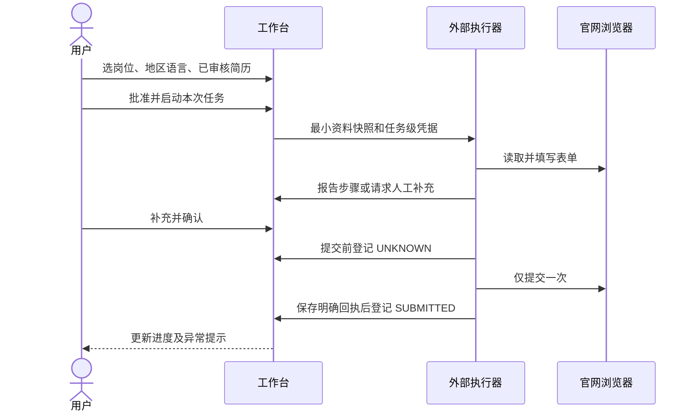
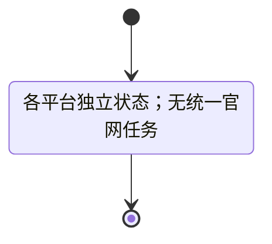
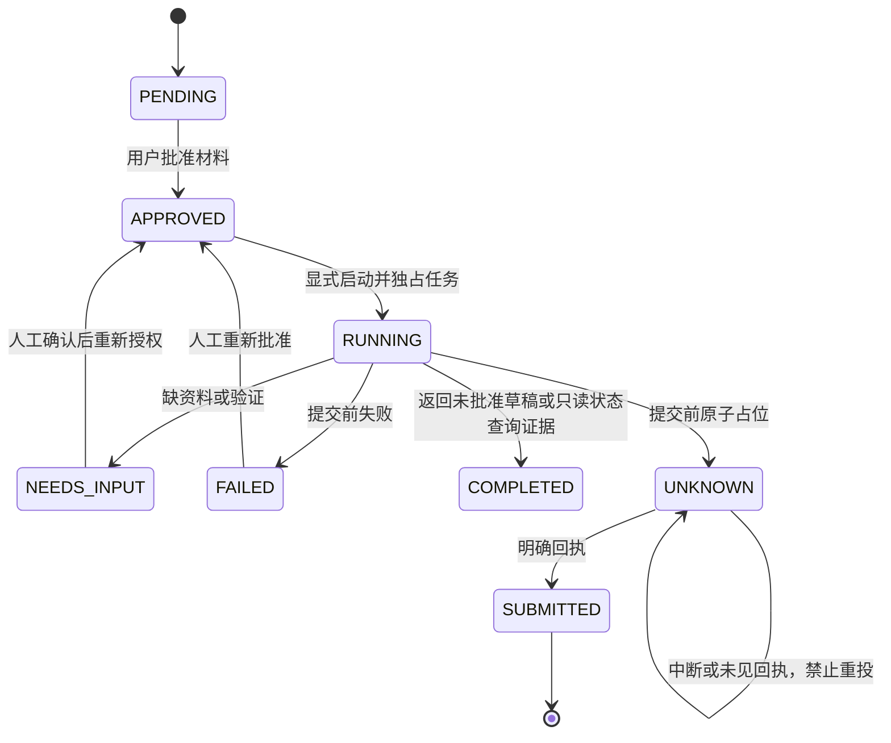
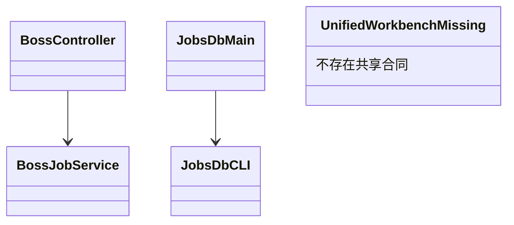
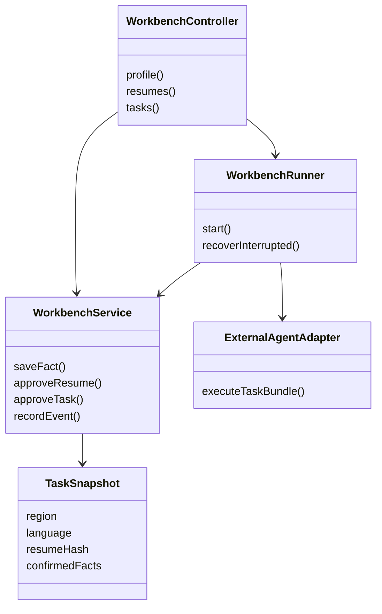

# 统一求职工作台 V1

## 已授权范围

- 在 JobsDB 副本形成统一版本；原 `get_jobs/` 的文件、进程、数据库、浏览器均不修改。
- 复用国内 Java/Spring/管理页面和 JobsDB Python CLI；不引入公司专用官网驱动或新的浏览器 Agent 框架。
- 共享已确认的个人资料，按 COMMON、HK、MAINLAND、网站作用域区分；凭据和浏览器会话不进入资料库。
- 简历按地区、语言独立保存，岗位版本另存，人工批准后才能用于申请；不自动同步其他版本。
- 官网由配置的外部通用 AI 执行器操作浏览器。工作台管理岗位、授权、资料快照、执行事件、人工阻塞、回执。执行器缺失必须显式报错。
- 平台正常投递复用脚本，不添加逐次模型调用。官网/简历任务仅在明确启动时调用外部执行器。
- 实验项目仅记录待补强卡片，不自动启动编码。
- 界面展示任务事件，失败/待人工处理触发本机通知（需用户授权）；企业招聘状态仅用户点击只读查询任务后更新，保留查询证据和检查时间，不改写原申请执行状态。
- 开发测试使用临时数据库、脱敏样例和 fake executor；不登录、不发送真实申请。

## 最小合同

工作台 Module 拥有个人资料、简历版本和任务不变量；浏览器、模型和现有平台运行细节留在各自 Adapter 中。

- 个人资料记录包含来源、确认状态与作用域；资料导入先预览，不直接将旧文件全部视为已确认。
- 简历附件复制到隔离的本地目录，绑定 SHA256；已批准版本不就地修改。
- 岗位任务保存地区、语言、渠道、岗位链接及所选简历。批准绑定当时的简历/资料快照；更换材料需要重新批准。
- 任务启动前检查批准和执行器可用性；同一任务不能并发启动。
- 外部执行器使用任务级凭据报告该任务事件，仅向其交付任务快照，不交付全库。执行器是用户配置的可信本机程序，V1 不是操作系统沙箱。
- 真正点击提交前先登记 UNKNOWN；未知结果禁止自动重投。只有提供明确回执才能登记 SUBMITTED。
- 失败、缺资料、等待人工、未知结果必须可见；进程退出 0 或输出“完成”不代表成功投递。
- 外部招聘状态不等于工作台执行状态，不伪装实时招聘反馈。
- 数据默认本地保存，管理入口仅绑定 loopback；跨站请求不能读取/修改个人资料。

## 图：当前架构

## 图：目标架构

## 图：当前时序

## 图：目标时序

## 图：当前状态

## 图：目标状态

## 图：当前局部类

## 图：目标局部类

## 验收

- [ ] 新工作台可运行，不必先启动真实招聘浏览器。
- [ ] 临时库测试覆盖资料作用域、四类简历、人工审核、不可变快照和未知结果防重。
- [ ] 外部执行器合同用 fake process 端到端验证；未配置不能伪装可执行。
- [ ] UI 可管理资料、简历、岗位/补强任务，展示步骤、阻塞、回执与检查时间。
- [ ] 原国内目录及本地私有资料不修改，不提交到 Git。
- [ ] 相关完整测试与 focused review 完成，实际官网登录和实投明确留作用户授权验收。

## 暂不包含

全天候雇主状态抓取、公司专属适配器、自动补强项目执行、复杂向量检索、微信/邮件通知、未经验证的全部上游更新。
